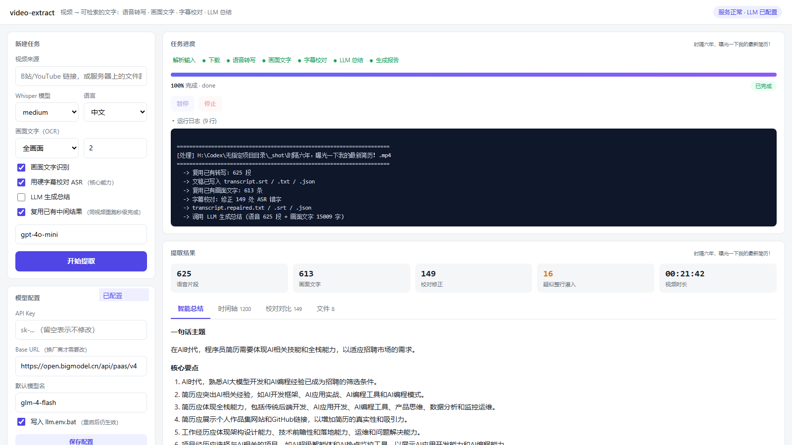

# video-extract —— 自动化提取视频内容

把视频变成**可检索、可复制的文字**：语音转写（带时间戳）+ 画面文字 OCR（硬字幕 / PPT）→ 合并成一份 `report.md`。

<p align="center">
  
</p>

> Web 界面：左侧填参数，右侧实时进度与提取结果（统计、时间轴、校对对比、下载）


---

## 一、快速开始（2 步）

```powershell
# 1. 安装环境（装 ffmpeg + 建 conda 环境 + 装依赖，约 300MB）
powershell -ExecutionPolicy Bypass -File setup.ps1

# 2. 关掉终端重开，然后跑
conda activate videoextract
python extract.py "D:\videos\我的视频.mp4"
```

跑完在 `.\output\<视频名>\report.md` 看结果。

> 不想用命令行？见第十六节：`python server.py` 起一个网页界面，提交任务后能看到
> 实时进度、时间轴、校对对比与 LLM 总结。

> 首次运行会自动下载 Whisper 模型（medium 约 1.5GB，只下一次）。

---

## 二、视频内容其实分三层，按需取用

| 层 | 内容 | 本工具 | 说明 |
|---|---|---|---|
| 🗣 语音层 | 说了什么 | ✅ 默认开启 | faster-whisper 转写，产出 SRT + 纯文本 + JSON |
| 🖥 画面层 | 硬字幕 / PPT / 表格文字 | ✅ `--ocr` | 抽帧 + RapidOCR + 连续去重 |
| 🎬 视觉层 | 场景、人物、动作 | ❌ | 需要多模态大模型，见文末 |

**关键提速技巧**：如果视频平台自带字幕轨（B站 CC、YouTube 自动字幕），本工具会自动优先下载使用，**比 ASR 又快又准**。想强制重新识别加 `--force-asr`。

---

## 三、输出说明

```
output/我的视频/
├── report.md          ← 主产出：时间轴 + 画面文字 + 逐字稿 + (可选)AI总结
├── transcript.srt     ← 标准字幕，可直接丢进播放器 / 剪映 / Premiere
├── transcript.txt     ← 纯文本，方便喂给大模型
├── transcript.json    ← 带 start/end 时间的结构化数据，方便二次开发
└── screen_text.json   ← 画面文字时间轴（--ocr 时生成）
```

`report.md` 里的时间轴长这样，语音和画面按时间顺序交织：

```
- `[00:00:01]` 🗣 大家好，今天我们讲数据质量监控
- `[00:00:05]` 🖥 第一章 数据质量六维度
- `[00:00:12]` 🗣 完整性指的是记录是否缺失
```

---

## 四、参数速查

### 语音转写
| 参数 | 说明 |
|---|---|
| `--model` | `tiny`/`base`/`small`/`medium`/`large-v3`。**默认 medium**，中文推荐 `large-v3` |
| `--lang` | `zh` / `en` / `ja`；不写则自动检测（中文视频建议显式写 `zh`） |
| `--initial-prompt` | 提示词，**专业术语/人名识别神器**，见下方技巧 |
| `--device` / `--compute-type` | 默认 `auto`（有 CUDA 自动用 GPU，失败自动退回 CPU/int8） |
| `--keep-audio` | 保留抽出的 wav（调试用） |
| `--no-asr` | 只要字幕轨，不做语音识别 |

### 画面文字
| 参数 | 说明 |
|---|---|
| `--ocr` | 开启画面文字识别 |
| `--ocr-region bottom` | **只认底部 35%**（字幕带）。硬字幕场景强烈推荐，快且准 |
| `--ocr-interval` | 抽帧间隔秒，默认 2。字幕停留短就调 1 |
| `--ocr-max-width` | 缩放到指定宽度再 OCR，如 `1280`，4K 视频提速明显 |

### 其他
| 参数 | 说明 |
|---|---|
| `input` | **可传多个**：文件、目录（递归找视频）、在线链接 |
| `--out` | 输出目录，默认 `./output` |
| `--summarize` | 用 LLM 生成结构化总结（需 `OPENAI_API_KEY`） |

---

## 五、常见场景配方

```powershell
# ① 中文教程视频，要精度，画面有 PPT
python extract.py "D:\v\course.mp4" --model large-v3 --lang zh --ocr --ocr-max-width 1600

# ② 视频只有烧录的硬字幕（没人声或不需要人声）
python extract.py "D:\v\clip.mp4" --no-asr --ocr --ocr-region bottom --ocr-interval 1

# ③ 整目录批量处理
python extract.py "D:\v\培训录像" --model medium --lang zh --ocr --out "D:\提取结果"

# ④ B站 / YouTube 链接
python extract.py "https://www.bilibili.com/video/BV1xxxxxxxxx" --lang zh

# ⑤ 会议录音整理 + AI 总结
$env:OPENAI_API_KEY = "sk-..."
python extract.py "D:\v\meeting.m4a" --model large-v3 --lang zh --summarize
```

---

## 六、效果优化技巧

**1. 术语识别不准 → 用 `--initial-prompt` 喂术语表**

Whisper 会参考这段文字修正输出，专业名词命中率大幅提升：

```powershell
python extract.py "course.mp4" --lang zh `
  --initial-prompt "本次内容涉及：数据仓库、Tableau、Power Query、SQL、ETL、数据质量六维度、完整性、一致性、唯一性。"
```

**2. 数字/英文缩写总错 → 换 `large-v3`**

模型越大对这些越准。`large-v3` CPU 上大约接近实时速度，60 分钟视频约跑 40-80 分钟。

**3. 有 NVIDIA 显卡想提速**

`faster-whisper` 用的是 CTranslate2，**不依赖 PyTorch**，但需要 CUDA 运行库：

```powershell
conda install -n videoextract -c conda-forge cuda-cudnn cuda-cudart -y
```

然后 `--device cuda --compute-type float16` 或直接 `--device auto`。GPU 下 `large-v3` 通常能到 20-50 倍实时速度。

**4. 长视频先分段**

超过 2 小时的视频建议先切分再跑，避免单进程内存堆积：

```powershell
ffmpeg -i long.mp4 -c copy -f segment -segment_time 1800 -reset_timestamps 1 part_%03d.mp4
```

---

## 七、不想写代码的替代方案

| 场景 | 工具 | 特点 |
|---|---|---|
| 中文视频、要省事 | **通义听悟** / **飞书妙记** | 在线、带说话人分离、自动摘要，免费额度够用 |
| 纯本地、要隐私 | **WhisperDesktop** | GUI 版 whisper.cpp，双击就能用，无需 Python |
| 只提取硬字幕 | **Video Subtitle Extractor** | 专治烧录字幕，OCR 框选区域后批量导出 SRT |
| 手工精修字幕 | **Subtitle Edit** | 时间轴对齐、错别字批改最强 |
| 剪辑软件内 | **剪映「智能字幕」** | 识别完直接生成字幕轨，顺手剪辑 |

---

### 多 P（分 P）视频

多 P 视频会被 yt-dlp 下载成多个文件（`<id>_p1.mp4`、`<id>_p2.mp4`…），
本工具**只处理第一个分 P**，并在日志里提示还有几个：

```
[提示] 该链接包含 3 个分 P，本次只处理第一个: BV14rpH6PEEF_p1.mp4
       需要处理其它分 P 请单独传入对应链接。
```

> 📌 **踩坑记录**：早期版本的找文件逻辑是 `glob(f"{vid_id}.*")`，
> 而多 P 的文件名分隔符是**下划线**不是点，于是一个文件都匹配不到，
> 最后误报"下载完成但没找到视频文件"——实测一个 3 分 P 的 1.6GB 视频
> 白等了 32 分钟后失败。已改为按"以 id 开头"匹配，两者都兼容。

## 八、已知局限

1. **说话人分离（谁说的）本工具没做** —— 需要 `pyannote.audio` 或云端方案（通义听悟支持）。
2. **背景音乐/多人抢话**场景 ASR 准确率会下降，建议开 `vad_filter`（默认已开）。
3. **画面理解**（"画面里发生了什么"）需要多模态模型，本工具只做文字层面的 OCR。
4. **口音重或方言**：Whisper 对普通话方言有一定容忍度，纯方言建议先做语音增强或用专门的方言模型。
5. **OCR 会把背景花纹误识别成文字**，已用 `--ocr-min-score` 和连续帧去重降低噪声，必要时提高阈值到 0.75。

---

## 九、文件说明

| 文件 | 作用 |
|---|---|
| `extract.py` | 核心：输入解析 → ASR → OCR → 字幕校对 → 报告（CLI 与 Web 共用） |
| `server.py` | Web 服务：任务队列 + 真实进度上报 |
| `static/index.html` | 单文件前端界面 |
| `eval_repair.py` | 字幕校对质量评估（准确率 / 错误分类） |
| `eval/repair_gold.jsonl` | 人工标注金标集（149 条逐条判定） |
| `requirements.txt` | Python 依赖声明 |
| `setup.ps1` | 一键装 ffmpeg + conda 环境 + Python 依赖 |

---

## 十、字幕校对（重要能力）

很多视频自带**硬字幕**，那是人工校对过的，比 ASR 准得多。本工具会同时跑两条线：

- 🗣 **语音转写**：覆盖全部时间轴，可能有同音字错误
- 🖥 **画面 OCR**：读到硬字幕原文，逐字准确

然后按「时间重叠 + 文本相似度」把两者对齐，**用字幕文字替换转写里错的字**。

实测一个 5 分钟的中文视频（B站 BV1XK42147q2），medium 模型转写后自动修正 **99 处**错字：

| 转写原文 | 校对后 |
|---|---|
| 校照生 | 校招生 |
| 学生会经理 | 学生会经历 |
| 选调考工 | 选调考公 |
| 格兰式阳性举 | 革兰氏阳性菌 |
| 张景芳老师 | 张雪峰老师 |
| 考工 | 考公 |

关键设计点：

1. **相似度用 max(标准相似度, 包含度)** —— 字幕通常比 ASR 文本短（ASR 会带上"首先""那么"等语气词），只算标准相似度会漏匹配。
2. **时间容差 ±2.5 秒** —— 抽帧是离散的，字幕与语音段最多会错开约 2 秒。
3. **只截取匹配到的那一段** —— 画面装饰元素常和字幕被 OCR 串成一行（如 `不加腊的氨基 对不对只有你是什么学校的`），整行替换会把噪声带进文稿，所以按空格分隔的完整片段裁剪。
4. **同一条字幕可被相邻语音段复用** —— ASR 常把一句话切成两段，复用不会产生重复文字，因为每段只取自己匹配的那部分。

加 `--no-repair` 可关闭校对，保留原始转写。

---

## 十一、调参不必重跑

ASR 和 OCR 是最慢的两步。调报告、试参数时用 `--reuse` 复用输出目录里已有的结果：

```powershell
python extract.py "视频链接" --reuse --out output
```

实测：完整流程约 6 分钟 → `--reuse` **1.7 秒**。

---

## 十二、实战踩坑记录（Windows 实测）

搭这套东西时踩到的坑，都已修好，记下来免得再犯：

**1. `powershell.exe` 是 5.1，会按 GBK 读无 BOM 的 .ps1 文件**

带中文的脚本如果存成 UTF-8 **无 BOM**，Windows PowerShell 5.1 会按 GBK 解码，中文字节可能"吞掉"后面的引号，导致莫名奇妙的 `Unexpected token` 报错（`pwsh` 7 却正常）。**解决办法：脚本存成 UTF-8 with BOM**。`setup.ps1` 已按此保存。

**2. `winget install ffmpeg` 在国内常失败**

报 `InternetOpenUrl() failed. 0x80072efd`，因为要连 GitHub。**解决办法：改用 pip 拿内置静态二进制**，速度快且不需要管理员权限：

```powershell
pip install imageio-ffmpeg
```

`extract.py` 现在会按四级顺序自动找 ffmpeg，无需改 PATH：

```
环境变量 FFMPEG_BINARY  →  系统 PATH  →  项目 tools\ffmpeg.exe  →  imageio-ffmpeg 内置
```

本项目已经把二进制放在 `tools\ffmpeg.exe`（7.1，83MB）。

**3. HuggingFace 模型下载在国内会挂**

- 走镜像：`$env:HF_ENDPOINT = "https://hf-mirror.com"`
- 但镜像**不代理新的 Xet 存储**，会报 `401 Unauthorized`，必须禁用：`$env:HF_HUB_DISABLE_XET = "1"`

两个都要设，缺一不可。

**4. `conda run` 在 GBK 控制台会崩**

`UnicodeEncodeError: 'gbk' codec can't encode character`。直接调用环境里的 python 更稳：

```powershell
& "E:\Anaconda\envs\videoextract\python.exe" extract.py ...
```

或用 `-X utf8` 并设 `$env:PYTHONIOENCODING = "utf-8"`。

**5. Python 3.14 装不了 `faster-whisper`**

`ctranslate2` 还没有 3.14 的轮子。必须单独建 3.11 环境（`setup.ps1` 已处理）。

---

## 十三、输出文件速查

| 文件 | 说明 |
|---|---|
| `report.md` | 汇总报告：时间轴（语音+画面文字交织）+ 校对后逐字稿 + 未校对原文 |
| `transcript.repaired.srt` | **校对后字幕**，推荐直接用于播放器/剪映 |
| `transcript.repaired.txt` | 校对后纯文稿，推荐复制或喂给大模型 |
| `transcript.srt` / `.txt` / `.json` | 未校对的原始转写 |
| `screen_text.json` | 画面文字时间轴（含硬字幕、PPT、表格） |
| `output/_download/` | 在线视频的下载缓存，可安全删除 |

---

## 十四、第二个实测案例：21 分钟幻灯片视频（暴露了两个严重问题）

测的是 [时隔六年，曝光一下我的最新简历！](https://www.bilibili.com/video/BV1DCDjBRExV)（程序员鱼皮，21分42秒，1080p，幻灯片式讲稿，无字幕轨、有硬字幕）。

### 问题一：不同视频互相串了（严重）

第一次运行时，第二条视频的日志里出现了**第一条视频的结尾**。

原因：下载目录用了固定文件名 `source.mp4`，yt-dlp 看到文件已存在就**直接跳过下载**，于是复用了上一条视频。

修复：改成按视频 id 命名 `%(id)s.%(ext)s`，即 `_download/BV1DCDjBRExV.mp4`。

### 问题二：幻灯片把逐字稿"撑爆"（严重）

校对后文本从 6865 字**膨胀到 24325 字**（3.5 倍），混进 `codefather`(9处)、`新版Chrome`(4处)、`引言`(23处) 等。

原因链条：
1. 幻灯片类视频的 OCR 会把**整屏文字**（幻灯片正文 + 水印 + 浏览器栏 + 字幕）用空格拼成一条；
2. 而校对取"第一个匹配片段 → 最后一个匹配片段"，一旦首尾各匹配上一个片段，**中间的整页幻灯片全被吞进来**；
3. 更隐蔽的是：**用整屏原文打分、却替换进去提取出的核心**，两者不一致会导致选错字幕行。

修复（三处）：
- `_extract_core` 改为围绕"最长匹配"只在 **1~3 个相邻片段**的窗口内择优，绝不跨整屏；
- 打分对象改为**真正要替换进去的那段核心文字**；
- 替换方式从"整句替换"改为**只替换对不上的片段**（`_splice_correction`），保留语音里的其余内容，既不丢信息也无法吞幻灯片。

修复效果（同一份缓存数据）：

| 指标 | 修复前 | 修复后 |
|---|---|---|
| 校对后字数 | 24325（膨胀 3.5 倍） | 7346 |
| 上述幻灯片噪声词 | 45 处 | **0** |
| 有效错字修正 | — | 149 处 |

> ⚠️ **后续复核（2026-10-15）**：那 45 处噪声确实清零了，但**灌入问题没有根治**。
> 见第十五节——逐条人工判定 149 处修正后，仍有 19 处（12.8%）把本段没说的内容
> 灌进来，只是形态更隐蔽（不再是整屏，而是相邻行）。此处原先"归零"的表述已被修正。

### 问题三：Whisper 偶发输出繁体

21 分钟视频里检出 **62 段**含繁体字（如"對於…來說"）。已加入自动繁转简（`opencc`），可用 `--no-t2s` 关闭。

### 性能实测（i5-11320H 8 线程，无独显）

| 步骤 | 耗时 | 说明 |
|---|---|---|
| 下载 1080p+音频 | ~30 秒 | 63MB |
| ASR（medium, int8, 8线程） | ~13 分钟 | 约 1.7x 实时 |
| OCR（651 帧，1080p 密集文字） | ~25 分钟 | 约 1x 实时，是长视频的瓶颈 |
| `--reuse` 重算报告 | **1.7 秒** | 调参必备 |

**长视频提速建议**：`--ocr-interval 3` 可省 1/3 时间；或 `--ocr-max-width 1280`；只想取硬字幕就用 `--ocr-region bottom`（画面文字量骤降，速度大幅提升）。若视频没有硬字幕，直接 `--no-repair --no-ocr` 只跑 ASR 最快。

### 术语识别建议

技术视频里 Whisper 常把术语写错（`Java`→`加瓦`、`全栈`→`全站`、`自己`→`自已`）。硬字幕校对能修掉大部分，但**从源头修更省事**：

```powershell
python extract.py "视频" --lang zh --model large-v3 `
  --initial-prompt "内容涉及：Java、全栈、前端、后端、AI Agent、大模型、CRUD、MVP、PV、日活、作品集、简历、面试、JD、架构设计、策略模式、工厂模式"
```

### 顺手加的能力

- `--reuse`：复用已有转写/OCR，只重算报告（1.7 秒 vs 25 分钟）
- `--no-repair` / `--no-t2s`：关闭字幕校对 / 关闭繁转简
- `--cpu-threads`：CPU 推理线程数，0=用满所有核心（默认只用 4 线程，拉满后明显提速）

---

## 十五、校对质量评估：把"修正 149 处"变成可复核的指标

「修了 149 处错字」只是工作量，不是质量。本节给出质量口径与实测值。

```powershell
python eval_repair.py --out "output\<视频目录>"          # 输出指标
python eval_repair.py --out "output\<视频目录>" --dump   # 逐条明细与理由
```

### 指标口径

| 指标 | 定义 |
|---|---|
| **无副作用修正率** | (改对 + 等价替换) / 总修正数 —— 主指标 |
| 错误引入率 | 细分为「改错」与「整行灌入」两类 |
| 受影响段落占比 | 引入错误的段数 / 全篇段数 |

判定来自人工标注（`eval/repair_gold.jsonl`，149 条逐条判定）。
**标注是主观判断**，脚本同时保留逐条明细（`--dump`）供抽查复核。

### 实测结果（21 分钟幻灯片视频，625 段语音）

```
发生改动的段      : 149 / 625
无副作用修正率    : 71.8%      (改对 102 + 等价替换 5)
错误引入率        : 28.2%      (改错 23 + 整行灌入 19)
受影响段落占比    : 6.7%       (42/625 段)
```

| 判定 | 数量 | 占比 |
|---|---:|---:|
| 改对 | 102 | 68.5% |
| 等价替换 | 5 | 3.4% |
| **改错** | **23** | **15.4%** |
| **整行灌入** | **19** | **12.8%** |

**成因分布**：

| 成因 | 数量 | 说明 |
|---|---:|---|
| 同音/形近纠错 | 89 | 校对的主要价值所在（`运为→运维`、`加瓦→Java`、`字字珠鸡→字字珠玑`） |
| **OCR 误识反向改错** | **20** | ASR 本来是对的，被 OCR 的错字改坏（`几千→凡千`、`毕竟→毕竞`、`自己→自已`） |
| **同句被相邻段复用** | **19** | 整行字幕被多个语音段共用，导致内容灌入 |
| 术语或数字规范化 | 10 | `三样→3样`、`十秒钟→10秒钟` |
| 排版规范化 | 7 | `1.架构设计能力 → 维度一：架构设计能力` |
| 混入噪声字符 | 2 | `还有第七条 → Q第七条` |
| 内容丢失或语义被改 | 2 | `成果截图、用户评价 → 成果截图啊` |

### 两个可直接改进的方向

1. **OCR 误识反向改错（20 处）**：现在无条件信任字幕。可加一道校验——
   若替换前后的字都是常见字、且替换后不构成更常见的词，则不替换（或要求
   该字幕在相邻帧中重复出现才认定为"真实硬字幕"）。
2. **同句复用导致灌入（19 处）**：现在同一条字幕可被相邻多个语音段复用，
   但没有"已用过就不再整句复用"的约束。可按段切分字幕，避免整句重复。

### 顺带发现：长度启发式够用但不够全

界面上的"疑似整行灌入"是用**长度比例**判的（校对后长度 > 原文 1.6 倍）。
拿它与人工标注对比：

```
检出 16 / 实际 19     精确率 1.00   召回率 0.84   F1 0.91
```

精确率很高（不会误报），但会漏 3 处灌入——因为那 3 处的原文本就比较长，
灌入后长度变化不明显。要做严就得换判据（如字符级对齐后检测"超出原文的新增片段"）。

---

## 十六、Web 界面

```powershell
conda activate videoextract
pip install -r requirements.txt          # 已含 fastapi / uvicorn
python server.py                         # http://127.0.0.1:8000
```

界面分左右两栏：左侧填参数、看历史任务；右侧实时进度 + 四个结果标签页
（智能总结 / 时间轴 / 校对对比 / 文件下载）。

### 三个设计决策

* **单工作线程 + 队列，而不是并发**：ASR/OCR 是 CPU 密集型，丢进事件循环会堵死服务；
  且 `extract` 的进度钩子是模块级全局，串行执行才能保证进度不串台。
* **进度是真上报，不是猜的**：`extract.py` 暴露 `PROGRESS_HOOK` / `LOG_HOOK`，
  服务注入钩子直接拿阶段进度，**不去解析子进程输出猜进度**。
* **参数复用同一套定义**：界面参数先翻译成 CLI 参数，再交给
  `extract.build_parser()` 解析——以后加 CLI 参数，前端不会漏。

### 任务控制：暂停 / 继续 / 停止

界面上有三个按钮，后端对应三个端点：

| 方法 | 路径 | 说明 |
|---|---|---|
| POST | `/api/jobs/{id}/pause` | 请求暂停 |
| POST | `/api/jobs/{id}/resume` | 恢复运行 |
| POST | `/api/jobs/{id}/cancel` | 停止（排队中/暂停中同样可停） |

**生效粒度**是"检查点"——转写的每个分段、OCR 的每一帧、下载的每次进度回调、
以及各阶段之间。因为 ASR/OCR 都是第三方库里的阻塞调用，无法从外部中断单次推理，
所以用协作式检查点实现：

```
实测：暂停后进度立即冻结；恢复后继续；
      停止在 ASR 阶段约 9 秒内生效（延迟 = 距离下一个分段边界的时间），
      终态后再操作返回 409。
```

**两条已知限制**（都已写进界面提示）：

1. **暂停会占用唯一的工作线程**，暂停期间其他任务排队等待——直接"停止"才是释放办法。
2. **首次使用某个 Whisper 模型时会联网下载**（medium 约 1.5GB），下载过程无法中断，
   取消请求会在下载结束后、进入下一阶段时生效。

### 端口冲突处理

本项目默认用 **8000** 端口，同类工具也常占用它。启动时会先探测：

| 情况 | 行为 |
|---|---|
| 端口空闲 | 正常启动 |
| **已有本服务在跑** | 不再启动，直接打开浏览器（避免重复起进程） |
| **被其他程序占用** | 明确报错并提示换端口，不会静默失败 |

```
[错误] 端口 8000 已被其他程序占用。
解决办法（任选其一）:
  1) 换一个端口:  python server.py --port 8010      （双击启动则 start.bat --port 8010）
  2) 先结束占用 8000 的程序，再重新启动
```

识别"是否本服务"靠 `/api/health` 返回的结构，不会把别人的服务误认成自己人。

### 接口

| 方法 | 路径 | 说明 |
|---|---|---|
| GET | `/api/health` | 服务与 ffmpeg / LLM 配置状态 |
| GET / POST | `/api/settings` | 读写模型配置（GET 只返回 Key 掩码） |
| POST | `/api/jobs` | 创建任务 |
| GET | `/api/jobs` | 历史任务列表 |
| GET | `/api/jobs/{id}` | 任务状态与实时日志 |
| GET | `/api/jobs/{id}/result` | 结果（总结 / 时间轴 / 校对差异 / 文件） |
| GET | `/api/jobs/{id}/files/{name}` | 下载产物（已做目录穿越防护） |

### 实测（异常路径也验过）

```
非法路径 400 · 不存在的任务 404 · 未完成取结果 409 · 目录穿越 404
```

---

## 十七、配置模型（三类，别混）

这个项目里的"模型"指三件不同的东西：

| 类型 | 用途 | 怎么配 | 必须吗 |
|---|---|---|---|
| **ASR 模型** | 语音转写 | 界面下拉框 / CLI `--model` | 必用（有现成字幕轨时可跳过） |
| **LLM 模型** | 生成结构化总结 | 环境变量 + `--summary-model` | 可选 |
| **OCR** | 画面文字识别 | 无需配置（RapidOCR 内置） | 可选 |

### 1. ASR 模型（语音转写）

```powershell
python extract.py "视频.mp4" --model large-v3 --lang zh
```

| 档位 | 速度 | 说明 |
|---|---|---|
| tiny / base / small | 快 | 试跑用 |
| **medium**（默认） | 中 | 中文日常够用 |
| large-v3 | 慢 | 数字、英文缩写、专业术语明显更准 |

**首次使用某个档位会联网下载模型**（medium 约 1.5GB，只下一次）。
国内务必先配镜像，否则会卡在下载并最终超时：

```powershell
$env:HF_ENDPOINT = "https://hf-mirror.com"
$env:HF_HUB_DISABLE_XET = "1"     # 镜像不代理新版 Xet 存储，必须同时禁用
```

### 2. LLM 模型（生成总结）

走 OpenAI 兼容接口，三个环境变量：

| 变量 | 必填 | 说明 |
|---|---|---|
| `OPENAI_API_KEY` | 是 | 没配就跳过总结，其余功能不受影响 |
| `OPENAI_BASE_URL` | 否 | 不填走 OpenAI 官方；换厂商就改这里 |
| `--summary-model` | 否 | 默认 `gpt-4o-mini`；界面里也有输入框 |

**做法一（推荐）：直接在网页里配**

界面左栏有「**模型配置**」卡片，填 API Key / Base URL / 模型名后点保存：

* **立即生效，无需重启**——配置写进服务进程的环境变量，下一次请求就用到
* **Key 不会回显**：接口只返回掩码（如 `sk-tes…cdef`），前端拿不到完整值
* 勾选「写入 llm.env.bat」可持久化，重启后自动载入（该文件已在 `.gitignore` 中忽略）
* 输入会过滤 `换行 % & | < > ^` 等字符——这些值最终要写进 `.bat`，
  不过滤的话换行就能往里注入命令

**做法二：用 `llm.env.bat`（适合命令行/自动化）**

```powershell
copy llm.env.example.bat llm.env.bat
notepad llm.env.bat        # 填入自己的 Key
```

之后双击 `start.bat` 会自动载入，不用每次设环境变量。

常见服务商（网页里填，或写进 `llm.env.bat`）：

| 服务商 | `OPENAI_BASE_URL` | `--summary-model` 示例 |
|---|---|---|
| 智谱 BigModel | `https://open.bigmodel.cn/api/paas/v4` | `glm-4-flash`（免费档） |
| DeepSeek | `https://api.deepseek.com/v1` | `deepseek-chat` |
| 阿里云百炼 | `https://dashscope.aliyuncs.com/compatible-mode/v1` | `qwen-plus` |
| OpenAI | 不填（默认） | `gpt-4o-mini` |

> ⚠️ 两种方式的影响范围不同：
> **网页里配**——写进当前进程内存，立即生效，但**服务重启后失效**（除非勾了持久化）；
> **环境变量 / llm.env.bat**——只在启动时读取一次，改了要重启才生效。
> 界面右上角徽标实时显示是否已配置 LLM（未配置是红色）。
